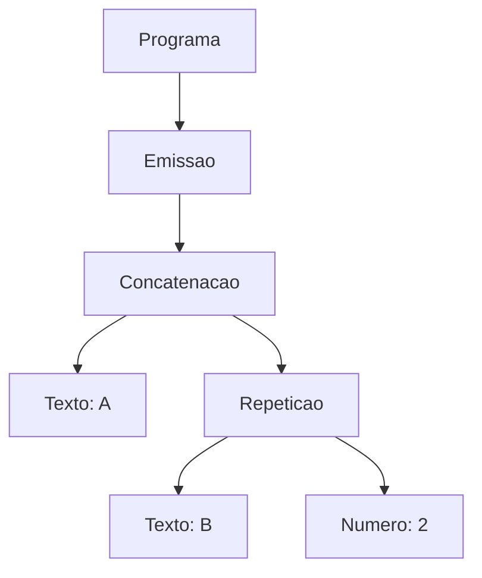

# Especificação da linguagem MorseLang

## 1. Para que serve a linguagem

MorseLang é uma linguagem pequena para compor mensagens que serão convertidas em código Morse. Um programa `.mf` define textos, tom e velocidade e usa `emitir` para produzir, na etapa de execução, arquivos `.morse` e `.wav`.

## 2. Programa de exemplo completo, comentado linha a linha

O conteúdo de `exemplos/ola.mf` é:

```text
// Uma mensagem curta para teste.
mensagem alerta = "SOS";
tom 600.0;
velocidade 20;
emitir (alerta + " AJUDA") * 2;
```

| Linha | Significado |
|-------|-------------|
| 1 | O comentário é descartado pelo analisador léxico. |
| 2 | `alerta` recebe o texto `SOS`. O nome é um identificador e o valor é um literal de texto. |
| 3 | O tom é ajustado para 600,0 Hz. `600.0` é um número real. |
| 4 | A velocidade é ajustada para 20 palavras por minuto. `20` é um inteiro. |
| 5 | O texto de `alerta` é concatenado com ` AJUDA`, incluindo o espaço inicial, e o resultado é emitido duas vezes. |

Na E2, o analisador confirma se os caracteres formam tokens válidos. A E3 implementada verifica a organização dos comandos e produz suas árvores sintáticas; o efeito de `emitir` será implementado na E4. Os exemplos válidos atuais são reconhecidos nos níveis léxico e sintático.

## 3. Que tipos de dado existem

| Tipo | Escrita | Uso |
|------|---------|-----|
| Texto | `"SOS"` | Mensagens e expressões emitidas. |
| Inteiro | `20` | Velocidade e quantidade de repetições. |
| Real | `600.0` | Frequência do tom; `tom` também pode receber um inteiro. |

Identificadores como `alerta` dão nome a valores de texto. Inteiros e reais não podem ter sinal negativo. Literais de texto ocupam uma linha, não aceitam aspas internas nem sequências de escape. Não há tipo booleano.

## 4. Que comandos existem

| Forma | Efeito previsto para a E4 |
|-------|----------------------------|
| `mensagem nome = expressão;` | Define um nome para um texto. |
| `tom número;` | Define a frequência do áudio em hertz. |
| `velocidade inteiro;` | Define a velocidade em palavras por minuto. |
| `emitir expressão;` | Acrescenta o texto produzido à saída Morse. |

`tom` e `velocidade` são opcionais, aparecem no máximo uma vez cada e usam 600 Hz e 20 palavras por minuto como padrão. Configurações e definições de mensagem devem vir antes de `emitir`; nomes devem ser definidos antes do uso e não podem ser redefinidos. O programa precisa ter ao menos um `emitir`. Vários comandos `emitir` acrescentam mensagens à mesma saída, com um espaço entre elas.

## 5. Que operadores existem, e com que precedência

`+` concatena dois textos sem inserir espaço. `*` repete um texto por uma quantidade inteira positiva. Parênteses agrupam expressões. A ordem de precedência, da maior para a menor, é: parênteses, `*`, `+`. `*` e `+` são associativos à esquerda. `=` aparece apenas na definição de `mensagem` e não participa de expressões.

## 6. Como são os comentários

`//` inicia um comentário que termina na quebra de linha ou no fim do arquivo. Comentários e espaços em branco são descartados pelo lexer. Dentro de um literal de texto, `//` faz parte do texto. Não há comentário de bloco.

## 7. Três coisas que a linguagem deliberadamente não faz

1. **Não oferece controle de fluxo geral.** Não há `se`, `enquanto` ou funções. O operador `*` cobre apenas a repetição de um texto. Para um primeiro projeto de compiladores, essa restrição mantém a gramática e a futura execução compreensíveis.

2. **Não decodifica Morse.** O fluxo planejado vai de texto para sinais e áudio. Decodificar exigiria outra entrada, regras de separação de sinais e tratamento de sequências inválidas. Isso pode ser uma extensão futura, mas não faz parte desta linguagem.

3. **Não permite alterar a tabela Morse nem promete suporte a todo Unicode.** A tabela é fixa. O lexer aceita caracteres Unicode dentro de aspas, mas a verificação de quais deles possuem código Morse pertence à análise semântica da E4 e ainda não está implementada. O tradutor antigo ignora caracteres desconhecidos com aviso; esse comportamento do protótipo não deve ser confundido com uma regra já implementada da nova linguagem.

## 8. Análise sintática e árvores (E3)

A gramática de parser está em [MorseLangParser.g4](../gramatica/MorseLangParser.g4), separada do lexer e ligada a ele por `tokenVocab=MorseLang`. A regra inicial é `programa : preambulo emissao+ EOF;`. O preâmbulo aceita declarações de mensagem e, opcionalmente, uma configuração de tom e uma de velocidade, em qualquer ordem. Declarações podem aparecer antes, entre ou depois das configurações. Depois da primeira emissão, somente outras emissões são permitidas.

As expressões são organizadas em três níveis:

```antlr
expressao : termo (MAIS termo)* ;
termo     : atomo (VEZES INTEIRO)* ;
atomo     : TEXTO | IDENT | ABRE_PAR expressao FECHA_PAR ;
```

Assim, `"A" + "B" * 2` agrupa como `"A" + ("B" * 2)`, enquanto `("A" + "B") * 2` repete a concatenação inteira. O lado direito de `*` é um literal inteiro: `"A" * 2` é aceito, mas `"A" * 2.5`, `"A" * quantidade` e `2 * "A"` são erros sintáticos. Não há expressões aritméticas numéricas nesta linguagem. A construção da AST associa cadeias à esquerda: `"A" * 2 * 3` produz `("A" * 2) * 3`.

A árvore concreta do ANTLR inclui as regras intermediárias, os parênteses, os pontos e vírgulas e o fim do arquivo. A árvore abstrata remove essa pontuação, mas mantém o agrupamento, os valores textuais e a ordem dos comandos. Para `emitir "A" + "B" * 2;`, a AST tem esta estrutura:



Os tipos da AST são `Programa`, `Mensagem`, `Tom`, `Velocidade`, `Emissao`, `Texto`, `Referencia`, `Numero`, `Concatenacao` e `Repeticao`. Cada nó registra a linha e a coluna inicial na fonte, contadas a partir de 1. O conteúdo de `Texto` não inclui as aspas delimitadoras. `Numero` guarda o lexema original, sem converter ou limitar seu valor durante o parsing.

A API `src.sintatico.analisar(fonte)` retorna um `ResultadoAnalise`: `programa` contém a AST e `arvore` contém a representação parentizada da árvore concreta. Um erro lança `ErroLexico` ou `ErroSintatico`, com linha, coluna e detalhe. O lexer verifica toda a fonte antes do parser; a análise não retorna uma árvore recuperada de uma entrada inválida.

## 9. Responsabilidade de cada etapa

| Regra | Etapa responsável | Situação |
|-------|-------------------|----------|
| Caracteres, palavras-chave, identificadores, números e textos | E2, lexer | Implementada |
| Pontuação, operandos, parênteses, precedência e associatividade | E3, parser e AST | Implementada |
| Pelo menos um `emitir` e consumo de toda a fonte | E3, parser | Implementada |
| Declarações e configurações antes das emissões | E3, parser | Implementada |
| No máximo um `tom` e uma `velocidade` | E3, parser | Implementada |
| Nomes definidos antes do uso e sem redefinição | E4, análise semântica | Pendente |
| Quantidade de repetições positiva e limites de tom e velocidade | E4, análise semântica | Pendente |
| Caracteres com representação em Morse | E4, análise semântica | Pendente |
| Aplicação dos padrões 600 Hz e 20 palavras/minuto, avaliação e geração de saídas | E4, execução | Pendente |

Portanto, a aceitação sintática de `emitir ausente;` ou `emitir "A" * 0;` não atesta a validade semântica desses programas. Nesta etapa nenhuma mensagem é emitida e nenhuma repetição é expandida.
