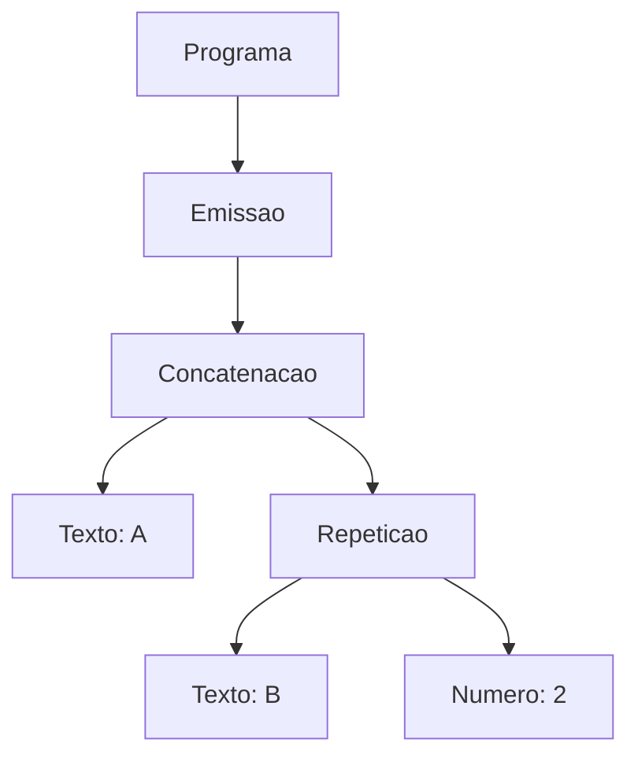

# Especificação da linguagem MorseLang

## 1. Para que serve a linguagem

MorseLang é uma linguagem pequena para compor mensagens que serão convertidas em código Morse. Um programa `.mf` define textos, tom e velocidade e usa `emitir` para produzir, após a execução e a geração, arquivos `.morse` e `.wav`.

## 2. Programa de exemplo completo, comentado linha a linha

O conteúdo de `exemplos/ola.mf` é:

```text
// Uma mensagem curta para teste.
mensagem alerta = "SOS";
tom 600.0;
velocidade 20;
emitir (alerta + " AJUDA") * 2;
```

| Linha | Significado |
|-------|-------------|
| 1 | O comentário é descartado pelo analisador léxico. |
| 2 | `alerta` recebe o texto `SOS`. O nome é um identificador e o valor é um literal de texto. |
| 3 | O tom é ajustado para 600,0 Hz. `600.0` é um número real. |
| 4 | A velocidade é ajustada para 20 palavras por minuto. `20` é um inteiro. |
| 5 | O texto de `alerta` é concatenado com ` AJUDA`, incluindo o espaço inicial, e o resultado é emitido duas vezes. |

Na E2, o analisador confirma se os caracteres formam tokens válidos. A E3 implementada verifica a organização dos comandos e produz suas árvores sintáticas. A E4 implementada valida nomes, repetições, configurações e caracteres, expande as emissões em uma timeline e grava as saídas `.morse` e `.wav`. Os exemplos válidos atuais passam pelas três análises.

## 3. Que tipos de dado existem

| Tipo | Escrita | Uso |
|------|---------|-----|
| Texto | `"SOS"` | Mensagens e expressões emitidas. |
| Inteiro | `20` | Velocidade e quantidade de repetições. |
| Real | `600.0` | Frequência do tom; `tom` também pode receber um inteiro. |

Identificadores como `alerta` dão nome a valores de texto. Inteiros e reais não podem ter sinal negativo. Literais de texto ocupam uma linha, não aceitam aspas internas nem sequências de escape. Não há tipo booleano.

## 4. Que comandos existem

| Forma | Efeito previsto |
|-------|-----------------|
| `mensagem nome = expressão;` | Define um nome para um texto. |
| `tom número;` | Define a frequência do áudio em hertz. |
| `velocidade inteiro;` | Define a velocidade em palavras por minuto. |
| `emitir expressão;` | Acrescenta o texto produzido à saída Morse. |

`tom` e `velocidade` são opcionais, aparecem no máximo uma vez cada e usam 600 Hz e 20 palavras por minuto como padrão. Configurações e definições de mensagem devem vir antes de `emitir`; nomes devem ser definidos antes do uso e não podem ser redefinidos. O programa precisa ter ao menos um `emitir`. Vários comandos `emitir` acrescentam mensagens à mesma saída, com um espaço entre elas. A análise semântica aplica os padrões e valida as regras, a execução expande as emissões em uma timeline reproduzível e a geração converte essa timeline nos arquivos finais.

## 5. Que operadores existem, e com que precedência

`+` concatena dois textos sem inserir espaço. `*` repete um texto por uma quantidade inteira positiva. Parênteses agrupam expressões. A ordem de precedência, da maior para a menor, é: parênteses, `*`, `+`. `*` e `+` são associativos à esquerda. `=` aparece apenas na definição de `mensagem` e não participa de expressões.

## 6. Como são os comentários

`//` inicia um comentário que termina na quebra de linha ou no fim do arquivo. Comentários e espaços em branco são descartados pelo lexer. Dentro de um literal de texto, `//` faz parte do texto. Não há comentário de bloco.

## 7. Análise léxica (E2)

O lexer é gerado pelo ANTLR a partir de [MorseLang.g4](../gramatica/MorseLang.g4). A implementação Python está em [src/analise_lexica](../src/analise_lexica), separada em modelo de token, diagnóstico, analisador e CLI. A gramática define estas categorias:

| Categoria | Tokens | Escrita reconhecida |
|-----------|--------|---------------------|
| Palavras-chave | `MENSAGEM`, `TOM`, `VELOCIDADE`, `EMITIR` | `mensagem`, `tom`, `velocidade`, `emitir` |
| Pontuação | `IGUAL`, `MAIS`, `VEZES`, `ABRE_PAR`, `FECHA_PAR`, `PONTO_VIRGULA` | `=`, `+`, `*`, `(`, `)`, `;` |
| Número inteiro | `INTEIRO` | um ou mais dígitos ASCII, como `20` e `007` |
| Número real | `REAL` | dígitos, um ponto e ao menos um dígito, como `600.0` |
| Texto | `TEXTO` | aspas duplas envolvendo uma linha sem aspas internas, barra invertida ou quebra de linha |
| Identificador | `IDENT` | letra ou `_`, seguida de letras, dígitos ou `_` |
| Descartados | `COMENTARIO`, `ESPACO` | `//` até o fim da linha e espaços em branco |

O ANTLR usa a maior correspondência possível. Por isso, `mensagem_extra` e `tomate` são identificadores, não palavras-chave seguidas de outro token. Comentários e espaços não chegam ao parser. O texto do token preserva o lexema original; no caso de `TEXTO`, as aspas fazem parte de `TokenInfo.texto`.

Cada token registra linha e coluna iniciais contadas a partir de 1. A API `src.analise_lexica.analisar(fonte)` devolve `list[TokenInfo]`; `iterar_tokens(fonte)` produz os mesmos tokens sob demanda. `criar_lexer(fonte)` devolve o lexer ANTLR configurado para o parser reutilizar. O primeiro erro interrompe a análise e lança `ErroLexico`, com linha, coluna e detalhe. A CLI em `src/lexico.py` lista `tipo`, texto, linha e coluna e retorna 0 no sucesso, 1 em erro de leitura ou léxico e 2 em uso incorreto.

## 8. Três coisas que a linguagem deliberadamente não faz

1. **Não oferece controle de fluxo geral.** Não há `se`, `enquanto` ou funções. O operador `*` cobre apenas a repetição de um texto. Para um primeiro projeto de compiladores, essa restrição mantém a gramática e a futura execução compreensíveis.

2. **Não decodifica Morse.** O fluxo planejado vai de texto para sinais e áudio. Decodificar exigiria outra entrada, regras de separação de sinais e tratamento de sequências inválidas. Isso pode ser uma extensão futura, mas não faz parte desta linguagem.

3. **Não permite alterar a tabela Morse nem promete suporte a todo Unicode.** A tabela é fixa. O lexer aceita caracteres Unicode dentro de aspas, e a análise semântica da E4 rejeita os que não têm representação Morse; letras acentuadas são normalizadas e espaços separam palavras. O tradutor antigo ignorava caracteres desconhecidos com aviso, mas esse comportamento do protótipo não vale para MorseLang.

## 9. Análise sintática e árvores (E3)

A gramática de parser está em [MorseLangParser.g4](../gramatica/MorseLangParser.g4), separada do lexer e ligada a ele por `tokenVocab=MorseLang`. A regra inicial é `programa : preambulo emissao+ EOF;`. O preâmbulo aceita declarações de mensagem e, opcionalmente, uma configuração de tom e uma de velocidade, em qualquer ordem. Declarações podem aparecer antes, entre ou depois das configurações. Depois da primeira emissão, somente outras emissões são permitidas.

As expressões são organizadas em três níveis:

```antlr
expressao : termo (MAIS termo)* ;
termo     : atomo (VEZES INTEIRO)* ;
atomo     : TEXTO | IDENT | ABRE_PAR expressao FECHA_PAR ;
```

Assim, `"A" + "B" * 2` agrupa como `"A" + ("B" * 2)`, enquanto `("A" + "B") * 2` repete a concatenação inteira. O lado direito de `*` é um literal inteiro: `"A" * 2` é aceito, mas `"A" * 2.5`, `"A" * quantidade` e `2 * "A"` são erros sintáticos. Não há expressões aritméticas numéricas nesta linguagem. A construção da AST associa cadeias à esquerda: `"A" * 2 * 3` produz `("A" * 2) * 3`.

A árvore concreta do ANTLR inclui as regras intermediárias, os parênteses, os pontos e vírgulas e o fim do arquivo. A árvore abstrata remove essa pontuação, mas mantém o agrupamento, os valores textuais e a ordem dos comandos. Para `emitir "A" + "B" * 2;`, a AST tem esta estrutura:



Os tipos da AST são `Programa`, `Mensagem`, `Tom`, `Velocidade`, `Emissao`, `Texto`, `Referencia`, `Numero`, `Concatenacao` e `Repeticao`. Cada nó registra a linha e a coluna inicial na fonte, contadas a partir de 1. O conteúdo de `Texto` não inclui as aspas delimitadoras. `Numero` guarda o lexema original, sem converter ou limitar seu valor durante o parsing.

A API `src.sintatico.analisar(fonte)` retorna um `ResultadoAnalise`: `programa` contém a AST e `arvore` contém a representação parentizada da árvore concreta. Um erro lança `ErroLexico` ou `ErroSintatico`, com linha, coluna e detalhe. O lexer verifica toda a fonte antes do parser; a análise não retorna uma árvore recuperada de uma entrada inválida.

## 10. Análise semântica (E4)

A implementação fica em [src/analise_semantica](../src/analise_semantica), separada em modelo de resultado, diagnóstico, analisador e CLI. [src/semantico.py](../src/semantico.py) é a fachada pública e a entrada da CLI. `analisar(programa)` recebe a AST da E3 e devolve um `ResultadoSemantico`; `analisar_fonte(fonte)` encadeia lexer, parser e análise semântica. O resultado contém o programa validado, as mensagens na ordem de declaração, as emissões e as configurações efetivas `tom` e `velocidade`, representadas por `Decimal` para preservar os lexemas originais.

As regras verificadas sobre a AST são:

1. **Nomes.** Uma `Referencia` só é aceita se o nome já apareceu em uma `Mensagem` anterior. A tabela de símbolos é global, os nomes diferenciam maiúsculas de minúsculas e a mesma mensagem não pode ser declarada duas vezes. A expressão de uma declaração é validada antes de o nome entrar na tabela, então `mensagem a = a;` falha. Em uma redefinição, o nome repetido é diagnosticado antes da expressão do novo comando.
2. **Repetição.** A quantidade deve ser um inteiro positivo. `0`, `00` e `000` são rejeitados; zeros à esquerda não tornam inválido um valor positivo, como `007`. O lexema não é convertido para inteiro, o que permite validar quantidades muito grandes sem overflow.
3. **Tom.** O valor deve estar no intervalo fechado de 100 a 20000 Hz. O padrão é 600 Hz. `99` e `20000.1` são rejeitados; `100` e `20000` são aceitos.
4. **Velocidade.** O valor deve ser um inteiro positivo em palavras por minuto; o padrão é 20. A especificação não fixa limite superior, portanto valores grandes são aceitos e preservados.
5. **Texto.** Todo literal é validado, inclusive em mensagens nunca emitidas. Cada caractere precisa existir na tabela Morse fixa depois da normalização de acentos; espaços em branco separam palavras e são aceitos, e o texto vazio é válido. Emojis, ideogramas e outros símbolos sem código Morse são rejeitados.

A análise percorre os comandos na ordem da fonte e interrompe no primeiro erro semântico, como as etapas anteriores. `ErroSemantico` informa linha, coluna e detalhe com posições contadas a partir de 1. A CLI `src/semantico.py` executa as três análises, imprime as configurações efetivas no sucesso, prefixa as falhas com `erro léxico:`, `erro sintático:` ou `erro semântico:` e retorna 0, 1 ou 2. Ela não gera `.morse` nem `.wav` e não expande repetições; a expansão pertence à etapa de execução descrita na seção 11.

## 11. Execução e timeline (E4)

A execução headless fica em [src/execucao](../src/execucao). `expandir(resultado)` recebe o `ResultadoSemantico` e devolve uma `Timeline` com `tom`, `velocidade`, `unidade_ms`, os textos expandidos, o texto final e a sequência de `Evento`. `expandir_texto(expressao, mensagens)` permite expandir uma expressão isolada. A CLI `python -m src.execucao arquivo.mf` imprime a timeline em JSON; `--resumo` reduz a saída e `--limite` protege interfaces interativas contra expansões muito grandes.

As emissões são expandidas resolvendo referências, concatenações e repetições. Emissões distintas são unidas por um espaço e espaços em branco são normalizados como separadores de palavra. As durações seguem o padrão PARIS, com `unidade = 1200 / velocidade` milissegundos:

| Elemento | Duração |
|----------|---------|
| Ponto | 1 unidade |
| Traço | 3 unidades |
| Silêncio entre símbolos | 1 unidade |
| Silêncio entre caracteres | 3 unidades |
| Silêncio entre palavras e emissões | 7 unidades |

Cada evento registra tipo (`tom` ou `silencio`), início e duração em milissegundos, motivo do silêncio, emissão de origem, caractere e, nos tons, o símbolo `.` ou `-`. Os eventos são contíguos: o fim de um é o início do próximo. Texto vazio não gera eventos. A execução em si não grava arquivos nem reproduz áudio; ela apenas produz a timeline que alimenta a geração e a interface.

## 12. Geração de `.morse` e `.wav`

A geração fica em [src/geracao](../src/geracao) e consome somente a `Timeline`. O módulo `texto.py` escreve um arquivo `.morse` com uma linha por comando `emitir`; dentro de cada linha, os caracteres são separados por um espaço e as palavras por ` / `. Esses separadores são notação textual: na timeline, o intervalo de palavra dura sete unidades. Emissões com texto vazio geram linhas vazias.

O módulo `audio.py` converte os eventos de tom em samples PCM de 16 bits e usa `wave` para gravar um arquivo mono. A frequência é o `tom` efetivo, a duração total vem dos eventos e os silêncios permanecem em zero. Uma curta rampa no início e no fim de cada tom evita estalos. A taxa de amostragem padrão é 44100 Hz e pode ser alterada. A CLI `python -m src.geracao arquivo.mf` grava ambos os arquivos ao lado da entrada; `--morse` e `--wav` permitem escolher caminhos e restringir a saída, e `--taxa` ajusta a amostragem. O alvo `make exportar` executa a CLI.

## 13. Visualização e reprodução (interface local)

A interface web fica em [src/visual](../src/visual). O servidor usa apenas a biblioteca padrão e, por padrão, escuta em `127.0.0.1:8000`. `GET /` serve a página estática; `GET /api/saude` (ou `GET /health`) informa o serviço e o limite de expansão; `POST /api/analisar` recebe `{"fonte": "..."}` e devolve tokens, AST, símbolos, tom, velocidade e timeline; `POST /api/exportar` recebe `{"fonte": "...", "formato": "morse"|"wav"}` e devolve o arquivo como anexo. Tanto a análise quanto a exportação usam o mesmo pipeline e os mesmos limites. A página envia a fonte a cada edição, com debounce, e preserva a resposta mais recente para evitar que análises antigas sobrescrevam a atual.

Erros das etapas de análise não são falhas HTTP: a resposta tem status 200, `ok: false`, a `etapa` (`lexico`, `sintatico`, `semantico` ou `execucao`), linha, coluna e detalhe, além dos tokens e da AST disponíveis até a falha. Requisições malformadas, métodos incorretos, corpos grandes demais e caminhos fora do diretório da interface retornam 4xx. O corpo é limitado a 1 MB e a expansão padrão a 10.000 caracteres; `--limite` ajusta esse teto.

A faixa da timeline desenha cada evento proporcionalmente à sua duração, distinguindo tons e os quatro motivos de silêncio. O botão de reprodução cria um `AudioContext` e agenda um único oscilador para toda a timeline, automatizando o ganho para soar apenas nos eventos de tom na frequência efetiva. O destaque do evento e o indicador de progresso usam `requestAnimationFrame` e o relógio do `AudioContext`, de modo que a animação acompanhe o áudio mesmo com variações de quadro. A reprodução pode ser pausada, retomada e reiniciada; uma nova análise invalida a reprodução anterior. Os botões de download chamam `/api/exportar` e disparam o salvamento dos arquivos gerados no navegador.

## 14. Responsabilidade de cada etapa

| Regra | Etapa responsável | Situação |
|-------|-------------------|----------|
| Caracteres, palavras-chave, identificadores, números e textos | E2, lexer | Implementada |
| Pontuação, operandos, parênteses, precedência e associatividade | E3, parser e AST | Implementada |
| Pelo menos um `emitir` e consumo de toda a fonte | E3, parser | Implementada |
| Declarações e configurações antes das emissões | E3, parser | Implementada |
| No máximo um `tom` e uma `velocidade` | E3, parser | Implementada |
| Nomes definidos antes do uso e sem redefinição | E4, análise semântica | Implementada |
| Quantidade de repetições positiva e limites de tom e velocidade | E4, análise semântica | Implementada |
| Caracteres com representação em Morse | E4, análise semântica | Implementada |
| Aplicação dos padrões 600 Hz e 20 palavras/minuto | E4, análise semântica | Implementada |
| Expansão das mensagens em timeline de tons e silêncios | E4, execução | Implementada |
| Visualização das análises e da timeline em tempo real | E4, interface web | Implementada |
| Geração de `.morse` e `.wav` a partir da timeline | E4, geração | Implementada |
| Reprodução da timeline com Web Audio | E4, interface web | Implementada |
| Download das saídas pela interface web | E4, interface web | Implementada |

Portanto, `emitir ausente;`, `emitir "A" * 0;` e `emitir "😀";` são aceitos pelo parser, mas rejeitados pela análise semântica. Nesta etapa as configurações são validadas, os padrões são aplicados, as emissões são expandidas em uma timeline, os arquivos `.morse` e `.wav` são gravados e a interface web reproduz os tons e silêncios.
